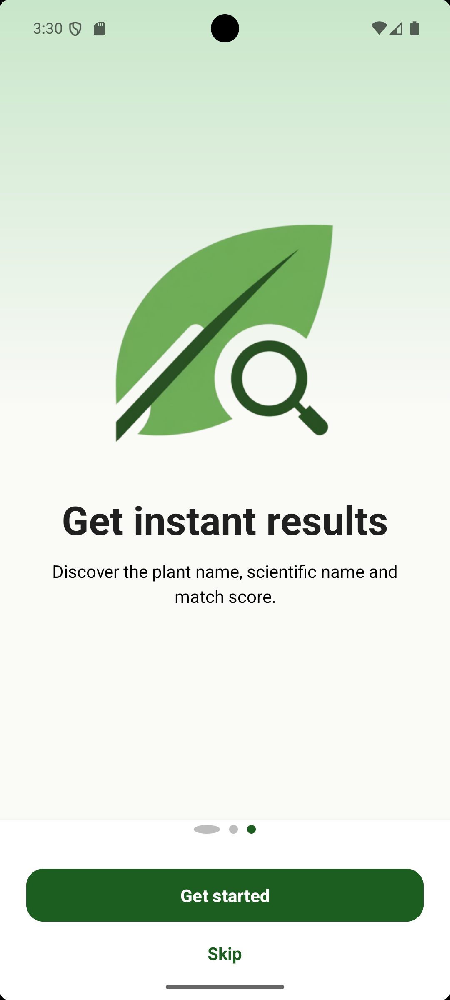
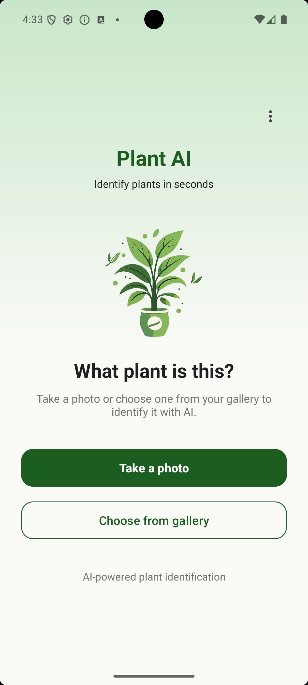
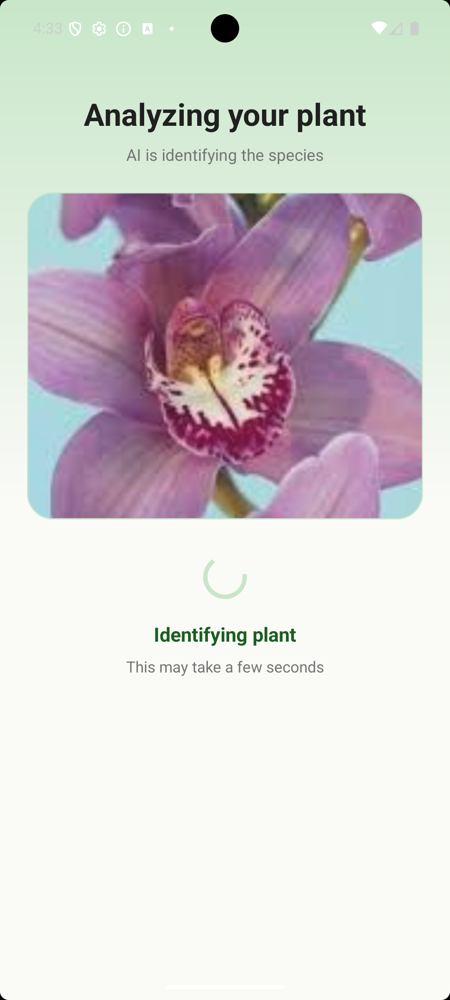
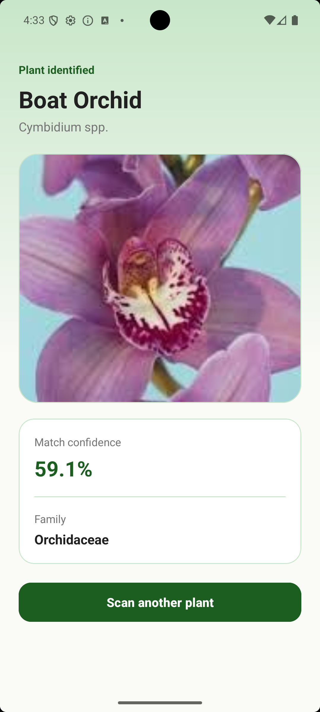

# Plant AI

Plant AI is an Android MVP that identifies plants from a photo using the PlantNet API. The product is designed around a simple user journey: capture or select an image, optionally specify the visible plant organ, and receive the most likely species with a confidence score and family information.

## Features

- First-launch onboarding with skip and completion flows
- Plant identification from camera or gallery
- Organ selection: leaf, flower, fruit, bark, habit, or unknown
- PlantNet results with common name, scientific name, family, and confidence
- English and Turkish interface options
- Loading, no-match, network-error, and retry states
- Image normalization to bounded JPEG files before upload
- Node.js proxy that keeps the PlantNet API key off the Android client
- Three user-acquisition concepts and storyboards in `AD_CONCEPTS.md` and `AD_STORYBOARDS.md`

## Project structure

```text
app/                  Android application
server/               Node.js PlantNet proxy
AD_CONCEPTS.md        Ad concepts for the case study
AD_STORYBOARDS.md     Production storyboards for the ad concepts
```

## Requirements

- Android Studio with an installed Android SDK
- JDK 21 or the JDK bundled with Android Studio
- Node.js 18 or newer
- A PlantNet API key

## Local setup

### 1. Start the proxy

From the project root, open a PowerShell window and run:

```powershell
$env:PLANTNET_API_KEY = "your-plantnet-api-key"
$env:PLANT_PROXY_TOKEN = "your-local-proxy-token"
cd server
npm start
```

The proxy runs on port `8787` by default. Check it with:

```powershell
Invoke-WebRequest http://localhost:8787/healthz
```

### 2. Configure the Android client

Add the following to the untracked root `local.properties` file:

```properties
PLANT_API_BASE_URL=http://10.0.2.2:8787/
PLANT_PROXY_TOKEN=your-local-proxy-token
```

Use `10.0.2.2` for an Android emulator. For a physical device, replace it with the computer's local Wi-Fi IP, for example:

```properties
PLANT_API_BASE_URL=http://192.168.1.X:8787/
```

The phone and computer must be on the same network. Windows Firewall may need an inbound rule for TCP port `8787`.

### 3. Build and test

```powershell
.\gradlew.bat clean testDebugUnitTest assembleDebug
```

The debug APK is generated at:

```text
app/build/outputs/apk/debug/app-debug.apk
```

## Architecture

The Android app uses Kotlin, XML layouts, Navigation, ViewModel, Retrofit, and coroutines. Images are normalized locally, then uploaded as multipart form data. The proxy forwards the request to PlantNet, validates the upload type, applies a request size limit and rate limit, and supports an optional proxy token.

```text
Android app -> Node.js proxy -> PlantNet API
```

The PlantNet API key is read only from the `PLANTNET_API_KEY` server environment variable.

## Why PlantNet?

PlantNet was selected because it provides a specialized image-based plant identification API and returns structured botanical metadata that maps directly to the product's result experience.

For an MVP, using an existing AI capability is more practical than training a custom image model. This keeps the implementation focused on product experience, API integration, feedback states, and iteration speed.

## Key Product Decisions

- The MVP focuses on one core action: identifying a plant from an image.
- Camera and gallery are the two primary entry points because they cover both discovery and existing-photo use cases.
- Organ selection gives users a lightweight way to improve identification quality without adding a complex form.
- A dedicated analysis state gives clear feedback while the remote model is processing.
- The result screen prioritizes plant identity first, followed by confidence and family metadata.
- Onboarding is limited to three short screens to explain the value without adding friction.
- The product does not claim to provide toxicity, safety, or medical advice; those capabilities are outside the current MVP scope.

## Testing

The core flow was tested on an Android physical device and emulator:

- First-launch onboarding
- Skip and Get Started navigation
- Camera capture
- Gallery selection
- Image normalization and upload
- PlantNet API identification through the proxy
- Loading and successful result states
- No-match and network-error handling
- Retry and scan-again flows
- English and Turkish language selection

Automated unit tests currently cover confidence-score formatting and clamping. Run all available checks with:

```powershell
.\gradlew.bat clean testDebugUnitTest assembleDebug
```

## Example Identification Output

The result experience presents the following structured information when returned by PlantNet:

```text
Common name:        returned by the API when available
Scientific name:    best match / species scientific name
Family:             botanical family
Match confidence:   normalized score displayed as a percentage
```

## Advertising Concepts

The case study also includes three advertising concepts designed for different audiences, platforms, and creative angles:

1. **3 Seconds Challenge** — “You had 3 seconds. AI didn't need them.”
2. **Know Before You Touch** — “Let's learn before we touch it.”
3. **Plant Parent** — “Turn curiosity into discovery.”

The concepts combine short-form social and YouTube-oriented creative formats while keeping the core product promise consistent: identify plants from a photo.

See `AD_CONCEPTS.md` and `AD_STORYBOARDS.md` for the full concepts, scripts, production notes, and storyboard specifications.

## Screenshots and Demo

The main product states are shown below:

| Onboarding | Home |
|---|---|
|  |  |

| Analysis | Result |
|---|---|
|  |  |

Watch the product flow in the [Plant AI demo video](screenshots/PlantAI.webm).

## Security notes

- Never commit `local.properties`, API keys, proxy tokens, or `.env` files.
- If an API key has previously been exposed, revoke it in the PlantNet dashboard and create a new one.
- Use HTTPS and a reverse proxy in production.
- The proxy token is only a basic abuse-control mechanism; a token embedded in an APK is not a true secret.
- The current in-memory rate limiter is suitable for the case/MVP, not a multi-instance production deployment.

## Product limitations and next steps

- Identification is a prediction, not a guaranteed diagnosis.
- There is no persistent scan history or account system in this MVP.
- Production work would add analytics events, remote monitoring, stronger abuse protection, automated UI tests, and a deployed HTTPS backend.
